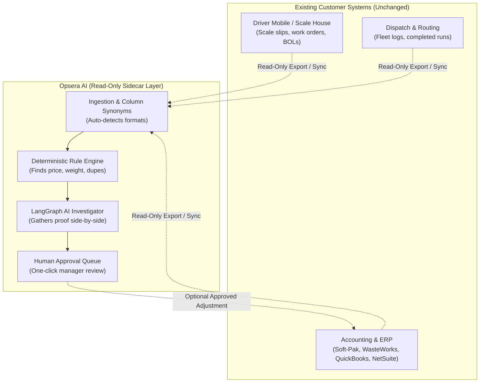
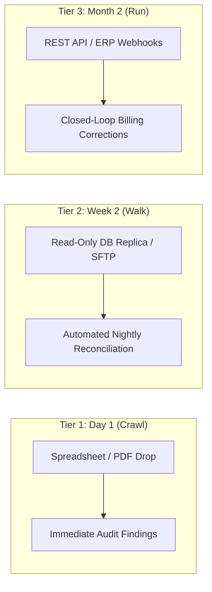
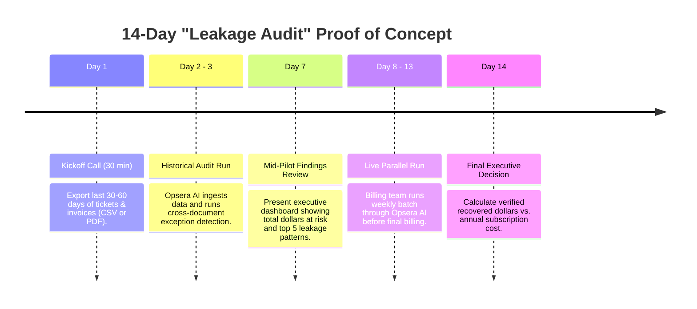

# Opsera AI — Enterprise Integration & Pitch Playbook

> **Executive Summary:** A comprehensive sales, architecture, and objection-handling guide designed to assure B2B industrial service, hauling, logistics, and supply chain executives that Opsera AI integrates seamlessly into their existing systems with **zero operational disruption**, **no ERP replacement**, and **zero initial IT overhead**. While Waste & Recycling serves as the initial reference showcase, the underlying engine is **100% industry-agnostic**.

---

## Table of Contents
1. [The Executive Pitch (30-Second Hook)](#1-the-executive-pitch-30-second-hook)
2. [Universal Architecture & Multi-Industry Expansion](#2-universal-architecture--multi-industry-expansion)
3. [Core Integration Philosophy: The Non-Invasive Sidecar](#3-core-integration-philosophy-the-non-invasive-sidecar)
4. [The 3-Tier Integration Ladder (Crawl, Walk, Run)](#4-the-3-tier-integration-ladder-crawl-walk-run)
5. [Industry Software & ERP Compatibility Matrix](#5-industry-software--erp-compatibility-matrix)
6. [Data Ingestion & Schema Alignment Specifications](#6-data-ingestion--schema-alignment-specifications)
7. [Enterprise Security & Governance Guarantees](#7-enterprise-security--governance-guarantees)
8. [Word-for-Word Objection Handling Scripts](#8-word-for-word-objection-handling-scripts)
9. [The 14-Day "Leakage Audit" Pilot Framework](#9-the-14-day-leakage-audit-pilot-framework)

---

## 1. The Executive Pitch (30-Second Hook)

### The Problem Industrial Leaders Face
Every B2B industrial hauling, field service, and logistics company bleeds **1% to 4% of top-line revenue** to operational exceptions:
- Jobs performed at signed contract rates that get invoiced at default price book rates.
- Scale house or facility weight slips showing 8.5 tons while the customer invoice bills 11.25 tons (or vice versa).
- Weekend emergency runs or extra labor performed by drivers/technicians that were never added to a customer bill.
- Duplicate invoices issued on separate billing cycles for the same job.

### The Pitch Verbatim
> *"We do not ask you to rip and replace your ERP, dispatch system, or scale software. Opsera AI functions as a **read-only audit sidecar**.*
> 
> *Your drivers keep using their existing tablets. Your dispatchers stay in their current dispatch screen. Your billing team keeps using QuickBooks, NetSuite, or Soft-Pak. Opsera AI quietly cross-examines the data flowing between those systems to catch discrepancies before customer invoices go out the door."*

---

## 2. Universal Architecture & Multi-Industry Expansion

### Why Waste & Recycling Was the Initial Anchor Vertical
The original reference showcase was built around commercial waste management and industrial recycling because it represents the **ultimate operational stress test**. 

In waste and recycling, an operator must reconcile **4 conflicting paper trails** for every single service event:
1. **The Dispatch Log** (what was scheduled in the route management system)
2. **The Driver's Field Ticket** (what was actually serviced, container size, driver signature)
3. **The Scale House Receipt** (certified gross vs. tare weight & tipping disposal fee)
4. **The Accounting Invoice** (what was actually billed to the customer)

Because these 4 records live in completely disconnected silos (telematics, scale indicators, driver paper/tablets, and accounting software), revenue leakage is systemic. **If an automated reconciliation engine can master waste management, it can seamlessly master any B2B logistics or field service business.**

### The Universal Core Data Model
The underlying database entities (`OperationalRecord`, `OperationalException`, `InvestigationDetail`, `Approval`) are intentionally abstract and industry-neutral:

- **`external_reference`**: Work Order #, Ticket #, Bill of Lading (BOL), Scale Slip, Manifest #, Dispatch ID
- **`customer_reference`**: Customer Name, Account #, Job Site, Facility ID
- **`service_date`**: Date of service, pickup, delivery, or billing
- **`quantity` & `unit`**: Tons, yards, gallons, hours, pulls, pallets, miles, loads, barrels
- **`rate` & `amount`**: Unit price ($) and extended total billed amount ($)

### The 5 Universal Exception Engines
Every industrial B2B operation experiences the same five failure modes:

| Exception Rule | What It Detects | Example Across Industries |
| :--- | :--- | :--- |
| **1. Rate Mismatch** | Price billed does not match agreed field ticket or contract rate. | Contract specifies $80/ton; billing clerk invoices at $95/ton (or underbills at $65/ton). |
| **2. Quantity Mismatch** | Invoiced quantity differs from physical measurement or weight slip. | Driver delivered 8.5 tons per certified scale slip; customer was billed for 11.25 tons. |
| **3. Unbilled Completed Job** | Work was marked completed in dispatch/field logs, but no invoice was ever issued. | Driver completed an emergency Saturday roll-off pull; ticket was never converted to an invoice ($1,450 leaked). |
| **4. Duplicate Billing** | The exact same job or ticket reference was billed across two different invoices. | Ticket #5544 charged on both Invoice #8801 and Invoice #8802. |
| **5. Dispatch Discrepancy** | Schedule or vehicle assigned in dispatch does not match actual field execution. | Truck reassigned morning of job; route cost misallocated to the wrong customer contract. |

### Multi-Industry Application Matrix
With **zero backend code changes**, Opsera AI can be pitched and deployed across multiple multi-billion-dollar industrial sectors:

| Industry Vertical | Primary Documents Reconciled | Revenue Leakage Prevented |
| :--- | :--- | :--- |
| **Commercial Waste & Recycling** | Driver tickets, scale receipts, dispatch logs, customer invoices | Tonnage over/under-billing, unbilled compactor pulls, duplicate disposal charges |
| **Aggregates, Sand & Gravel** | Quarry scale tickets, driver haul sheets, contractor bills | Pit gate fee variances, unbilled standby/waiting time, weight ticket discrepancies |
| **Ready-Mix Concrete** | Batch plant tickets, delivery pour slips, customer invoices | Short-load fees, extra water/chemical add-on fees, plant demurrage disputes |
| **Bulk Freight & Drayage** | Bills of Lading (BOL), scale slips, carrier freight bills | Fuel surcharge calculation errors, detention time disputes, weight classification errors |
| **Heavy Equipment Rental** | Dispatch mobilization logs, return condition inspections, rental invoices | Unbilled damage repairs, unbilled extra engine meter hours, transport charge mismatches |
| **Oilfield & Environmental Services** | Vacuum truck run tickets, disposal facility manifests, E&P operator invoices | Water haul volume disputes, unbilled weekend standby, manifest disposal fee mismatches |
| **Scrap Metal & Material Recovery** | Yard scale tickets, grading inspection slips, supplier settlement sheets | Metal grade downgrade disputes, improper scale tare deductions, pricing formula variances |

### Pitch Customization & White-Labeling (In Minutes)
When pitching a prospect outside waste management, you can customize the system in minutes:
1. **Tenant Branding**: Change the tenant switcher from *"Apex Industrial Waste & Recycling"* to your prospect's company name.
2. **Terminology & Units**: Configure units to match their business (`"tons, pulls, yards"` for hauling; `"hours, meters"` for equipment rental; `"pallets, miles"` for freight).
3. **Sample Templates**: Provide their specific document templates (e.g. `Bill of Lading` instead of `Scale Ticket`) via the built-in spreadsheet downloader.

---

## 3. Core Integration Philosophy: The Non-Invasive Sidecar

Most enterprise software pitches fail because they demand workflow changes. Opsera AI adheres to three strict architectural guardrails:

1. **Zero Write Permissions Required Initially:** Ingestion runs purely on read-only database replicas, automated report drops, or standard spreadsheet exports.
2. **Deterministic Math + AI Evidence Gathering:** Discrepancy calculations are 100% deterministic (no hallucinated numbers). AI is reserved for contextual document inspection and natural-language root cause explanation.
3. **Human-in-the-Loop by Design:** The system never issues rebills, credit memos, or adjustments automatically. A human operations manager must review the side-by-side evidence and click **Approve**.

---

## 4. The 3-Tier Integration Ladder (Crawl, Walk, Run)

We eliminate IT friction by offering three progressive integration levels. Customers typically start at Tier 1 on Day 1, move to Tier 2 in Week 2, and evaluate Tier 3 once ROI is proven.

### Tier 1: "Drop & Go" (Day 1 — Zero IT Involvement)
- **Mechanism:** Billing clerk or operations manager exports standard weekly CSV or Excel reports from their existing billing software, or drags PDF scale tickets into the browser.
- **Customer IT Effort:** **0 hours**.
- **Customer Reassurance:** *"You can test this today with last month's records. You don't need a single meeting with your IT department."*

### Tier 2: "Automated Read-Only Sync" (Week 2 — 1 Hour IT Setup)
- **Mechanism:** Read-only database user connection (PostgreSQL, MySQL, SQL Server) or a scheduled SFTP report drop. Opsera AI periodically pulls newly created tickets and invoices.
- **Customer IT Effort:** **< 1 hour** (creating a read-only credential).
- **Customer Reassurance:** *"Read-only access means our software has zero ability to write to, lock, or corrupt your production database tables."*

### Tier 3: "Closed-Loop Automation" (Month 2 — Enterprise)
- **Mechanism:** Two-way integration via webhooks or REST API. When an operations manager clicks **"Approve Fix"** on an overbilling or unbilled job, Opsera AI pushes the correction (or draft credit memo) back into their ERP.
- **Customer IT Effort:** **2–4 hours** (API key configuration).
- **Customer Reassurance:** *"The API only executes actions that an authorized human manager explicitly clicks to approve."*

---

## 5. Industry Software & ERP Compatibility Matrix

Opsera AI includes pre-configured schema mappings for the most widely deployed operational and accounting platforms in the industrial services and logistics sectors:

| System Category | Vendor / Product | How Opsera AI Connects | Data Extracted |
| :--- | :--- | :--- | :--- |
| **Specialized Waste ERP** | **Soft-Pak** | Read-only SQL replica or nightly export | Work orders, scale dumps, AR invoice lines |
| **Landfill & Scale Software** | **WasteWorks** | Direct ODBC / SQL connector or CSV drop | Gross/tare weights, scale tickets, tipping fees |
| **Hauler Operations** | **AMCS / Tower** | Standard reporting export or read replica | Route schedules, container pulls, customer rates |
| **Ready-Mix & Bulk** | **TRUX** | Read-only database query or CSV upload | Dispatch logs, hauling tickets, unit rates |
| **Accounting & Billing** | **QuickBooks Online / Desktop** | Direct Intuit API or standard CSV journal export | Customer invoices, line items, payment terms |
| **Mid-Market ERP** | **Sage Intacct / NetSuite** | Standard REST API or automated SFTP drop | General ledger lines, billing schedules, credit memos |
| **Fleet & Telematics** | **Samsara / Geotab** | Telematics webhook or driver log export | Time-on-site logs, geofence arrivals, missed stops |

---

## 6. Data Ingestion & Schema Alignment Specifications

### How We Handle "Dirty" Customer Data
Industrial companies often struggle with inconsistent data across facilities. Opsera AI utilizes an **Intelligent Synonym Engine** that automatically maps raw customer column names to canonical template fields:

| Canonical Opsera Field | Accepted Synonyms in Customer Reports | Status |
| :--- | :--- | :--- |
| `external_reference` | `ticket_number`, `ticket_no`, `tkt_id`, `invoice_no`, `inv_num`, `scale_ticket`, `manifest_no`, `dispatch_id`, `bol_number` | **Required** |
| `customer_reference` | `customer_name`, `customer`, `account_name`, `client`, `account_no`, `client_id`, `shipper`, `consignee` | **Required** |
| `service_date` | `date`, `job_date`, `ticket_date`, `pickup_date`, `delivery_date`, `scale_date`, `ship_date` | **Required** |
| `amount` | `total`, `line_total`, `total_amount`, `extended_price`, `charge`, `net_amount`, `freight_total` | **Required (or Qty × Rate)** |
| `quantity` | `qty`, `tons`, `weight_tons`, `net_weight_tons`, `yards`, `gallons`, `pulls`, `hours`, `pallets`, `loads` | Optional |
| `rate` | `unit_price`, `price_per_ton`, `price`, `haul_rate`, `hourly_rate`, `fuel_surcharge_rate` | Optional |
| `unit` | `uom`, `unit_of_measure`, `measurement`, `metric` | Optional |
| `status` | `job_status`, `ticket_status`, `dispatch_status`, `delivery_status`, `state` | Optional |

### Interactive Column Matcher
If a customer uses a proprietary or unconventional column header, the built-in **Template Conformance Validator** flags the unassigned column and provides a simple dropdown allowing the user to map it in under 10 seconds.

---

## 7. Enterprise Security & Governance Guarantees

| Security Domain | Operational Guarantee |
| :--- | :--- |
| **Multi-Tenant Isolation** | Strict isolation enforced at the application and database query levels (`X-Tenant-ID` header and database foreign key constraints). Zero cross-tenant data leakage. |
| **Read-Only Ingestion** | Database connections require only `SELECT` privileges on relevant operational views. |
| **No Global Model Training** | Customer proprietary contract pricing, customer lists, and financial figures are never used to train public or shared AI models. |
| **Deterministic Evidence Trail** | Every flagged exception generates an immutable audit log citing the exact primary documents (e.g., Ticket #TKT-4401 vs. Invoice #INV-9021). |
| **Role-Based Access Control** | Distinct roles for Dispatchers, Billing Clerks, Operations Managers, and System Admins. |

---

## 8. Word-for-Word Objection Handling Scripts

### Objection 1: "Our IT team has a 6-month backlog and won't approve a new software project."
> **The Script:**
> *"That is exactly why we built Opsera AI to start without IT. You don't need an API integration or server installation to see value. Your billing team can download our pre-formatted template or drop last week's CSV export right into the browser. We prove ROI and find leaked revenue on Day 1 before we ever ask your IT department for a single minute of their time."*

### Objection 2: "Our data is too messy. Different branches use different spreadsheets and naming conventions."
> **The Script:**
> *"Messy data is normal in industrial operations—it's the exact reason billing errors slip through in the first place. Our system has built-in fuzzy column matching. Whether Yard A calls it `scale_no` and Yard B calls it `ticket_id`, our validator detects and standardizes the columns automatically. You don't have to clean your spreadsheets before uploading."*

### Objection 3: "We can't risk an AI hallucinating and sending incorrect bills or credits to our customers."
> **The Script:**
> *"Opsera AI never touches customer billing directly. All math is deterministic—calculated by exact formulas, not generative text. The AI is used strictly as a digital paralegal that compares the two documents side-by-side and summarizes the evidence. Most importantly, nothing ever changes in your billing system until an authorized operations manager reviews the proof and clicks 'Approve'."*

### Objection 4: "We already have an ERP (Soft-Pak / WasteWorks / NetSuite / SAP). Why do we need this?"
> **The Script:**
> *"Your ERP is an excellent system of record, but it is not an exception auditor. ERPs record what you enter; they do not cross-examine driver tickets against scale tare weights and invoice lines to detect when a dispatcher keyed 8.5 tons as 11.25 tons. We don't replace your ERP—we protect it from bad data and revenue leakage."*

---

## 9. The 14-Day "Leakage Audit" Pilot Framework

When closing prospects, propose a structured 14-day risk-free pilot:

- **The Closing Hook:** *"Give us 30 days of historical data from one branch. If we don't find at least 3x our annual software fee in unbilled work, pricing mistakes, or double charges, you walk away paying nothing."*
