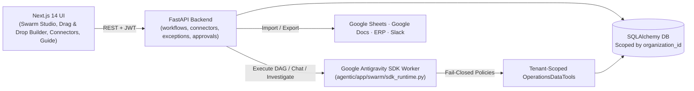

# Architecture Guide — Manufacturing Operations Swarm

## Overview

**Faktry AI Manufacturing Operations Swarm** helps discrete and process manufacturers eliminate hidden margin leaks and manual spreadsheet reconciliation. It monitors Purchase Orders, receiving dock scale tickets, CNC/shop-floor work orders, production schedules, and supplier/customer invoices inside a strict multi-tenant architecture.

## System Topology

## Google Antigravity SDK Layer (`agentic/`)

- **SDK Runtime (`agentic/app/swarm/sdk_runtime.py`)**: Configures `LocalAgentConfig` using `DEFAULT_MODEL` (`gemini-4-hydrogen`), strict least-privilege tool policies (`policy.deny_all()` + explicit `policy.allow(...)` allowlist), `hooks` telemetry instrumentation, structured Pydantic `response_schema`, and deterministic fallbacks when `GEMINI_API_KEY` is absent or running offline.
- **Swarm Investigation Workflow (`agentic/app/swarm/workflow.py`)**: Executes evidence lookup, mathematical discrepancy calculation, and proposal synthesis.
- **Visual Swarm Workflow DAG Runner (`execute_swarm_workflow_dag`)**: Topologically executes user-customized Drag & Drop workflows (`connector_input` -> `agent` -> `approval_gate` -> `connector_output`) and computes exact cost savings (`total_cost_savings_usd`) and time saved (`total_time_saved_minutes`).

## Multi-Tenant Data & Security Boundaries

- **Server-Side Tenant Isolation**: Every workflow (`SwarmWorkflow`, `SwarmRun`), app connector (`AppConnector`), operational record, exception, approval, and agent chat tool query filters strictly by `current_user.organization_id`.
- **SSRF & Credential Protection (`backend/app/api/routes/connectors.py`)**: Google Sheets and Docs URLs are validated strictly against `https://docs.google.com/...` paths; webhook URLs block loopback, private, and link-local IP ranges; credentials are never logged or returned raw (`secret_preview` masks tokens to `••••XXXX`).
- **Human-in-the-Loop Governance**: Financial adjustments at or above `$500` pause in `awaiting_approval` for one-click manager sign-off.
