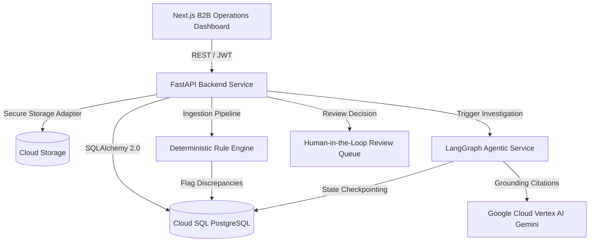
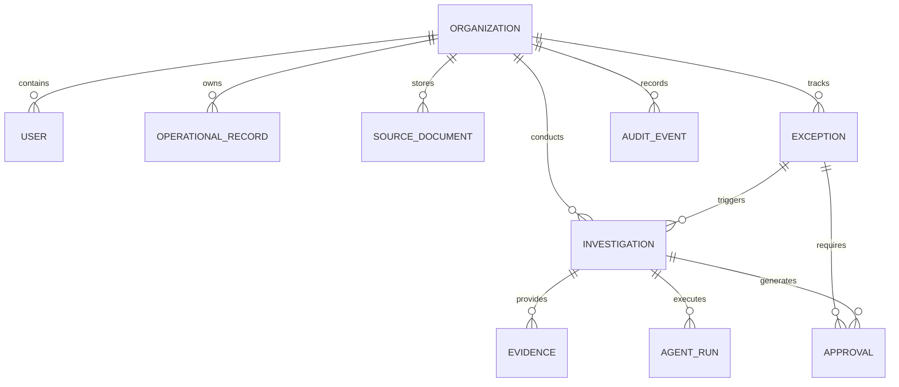

# System Architecture & Technical Specifications

## 1. Executive Summary

The **AI Operations Exception Agent** is a multi-tenant enterprise system engineered for waste management, commercial recycling, and industrial field-service companies. It reconciles operational discrepancies across invoices, driver-signed service tickets, certified disposal facility scale load tickets, and dispatch manifests.

---

## 2. Component Design

### 2.1 Backend Service (`backend/`)
- **FastAPI Core**: Async REST API handling multi-tenant isolation, RBAC (`admin`, `operations_manager`, `reviewer`), and CRUD operations.
- **Data Persistence**: SQLAlchemy 2.0 with Alembic migrations. Dual-mode support for PostgreSQL in cloud environments and SQLite for rapid local testing.
- **Storage Layer**: Pluggable `StorageAdapter` pattern supporting Google Cloud Storage with strict path sanitization (`os.path.basename` and resolved root verification) to prevent directory traversal (CWE-22).
- **Audit Subsystem**: Tamper-evident logging of every automated detection, agent execution attempt, and human review decision in `audit_events`.

### 2.2 Ingestion & Deterministic Rule Engine
- **Lightweight Robust Parser**: Ingests CSV manifests and operational spreadsheets without bulky dependencies.
- **Automated Column Mapping**: Canonical synonym dictionary automatically infers ticket numbers, customer references, quantities, rates, and amounts.
- **Deterministic Rules**:
  1. *Rate & Amount Mismatch*: Billed line amount vs. ticket rate × quantity.
  2. *Quantity & Weight Mismatch*: Billed tonnage vs. certified scale ticket net weight.
  3. *Unbilled Completed Jobs*: Completed service tickets omitted from customer invoicing.
  4. *Dispatch vs Ticket Discrepancy*: Vehicle ID or service date divergence between dispatch schedule and field driver ticket.
  5. *Duplicate Billing*: Redundant customer charges referencing the same ticket across multiple invoices.

### 2.3 Agentic Investigation Workflow (`agentic/`)
- **LangGraph Multi-Step Pipeline**:
  - `intake_and_scope`: Scopes exception context to the authenticated tenant.
  - `evidence_retrieval`: Extracts relevant records and compiles strict citations.
  - `deterministic_reconciliation`: Executes exact mathematical variance and percentage calculations.
  - `llm_root_cause_analysis`: Employs Gemini on Vertex AI to diagnose why the discrepancy occurred (e.g. scale calibration vs. estimation, driver reassignment, billing system omission).
  - `resolution_proposal`: Formulates concrete operational resolution (`credit_memo`, `rebill_invoice`, `dispatch_adjustment`, `dismiss_no_fault`).
  - `human_in_the_loop_gate`: Pauses automated actions and stages approval payload for human sign-off.
- **Zero Hallucination Constraint**: Strict prompt engineering and Pydantic validation ensure every claim cites real record IDs, actual quantities, and verified contract rates.

### 2.4 Frontend Operations Dashboard (`frontend/`)
- Built with **Next.js 14 App Router**, **TypeScript**, and **Tailwind CSS**.
- High-density B2B operations user interface prioritizing evidence visibility, side-by-side record comparison, and human approval efficiency over consumer animations.

---

## 3. Data Model Schema Relationships

